  

  I build <b>LLM-powered systems</b> that go beyond the demo — retrieval, agents, evaluation and the pipelines that keep them running in production.

---

### 🧠 What I work on

| | |
|---|---|
| 🔎 **RAG systems** | retrieval pipelines, chunking & embeddings, grounded answers over messy enterprise data |
| 🤖 **LLM agents** | tool use, multi-step workflows, agents that talk to real databases and APIs |
| 📄 **Document AI** | extracting structured data from PDFs, invoices, reports |
| ⚙️ **MLOps / LLMOps** | CI/CD for ML, experiment tracking, retraining, containerized deployments |
| 🔁 **Data pipelines** | scheduled ingestion & ETL feeding the models |

### 🛠 Tech stack

  
  
  
  
  
  
  
   
  
  
  
  
  
  

### 📌 Featured projects

| | |
|---|---|
| **[LLM-Based-ChatBot](https://github.com/Alicanayhn/LLM-Based-ChatBot)** Full-stack LLM chatbot — frontend, backend, Postgres, MLflow and a Jenkins pipeline, all in Docker Compose. | **[Chatbot-MLOps](https://github.com/Alicanayhn/Chatbot-MLOps)** Experiment tracking & model registry stack for the chatbot, built on MLflow. |
| **[Jenkins-With-Docker](https://github.com/Alicanayhn/Jenkins-With-Docker)** CI/CD playground: building, testing and shipping a containerized app with Jenkins. | **[Predictive Maintenance](https://github.com/Alicanayhn/Web-Based-Predictive-Maintenance-Project)** Web app that predicts equipment failures from sensor data with classic ML. |

### 📊 Stats — refreshed every night

  

  

  <picture>
    <source media="(prefers-color-scheme: dark)" srcset="https://raw.githubusercontent.com/Alicanayhn/Alicanayhn/output/github-snake-dark.svg" />
    
  </picture>

### ⚡ Fun facts

- 🐍 The snake above is eating my real commits — feed it by starring a repo 😄
- 🧪 Favorite debugging tool: asking the model *why* it said that
- 🎓 Computer Engineering @ Uludağ University
- 🌱 Currently exploring: agent evaluation & the Model Context Protocol (MCP)

### 📫 Let's connect

  
  
  

